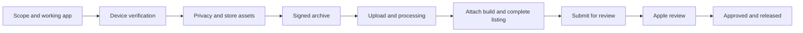

# AI-assisted iOS App Store Playbook

**A practical, bilingual guide from an app idea to a verified App Store review submission.** It captures the lessons from shipping two native iPhone apps with an AI coding assistant: a live listening companion and a recording-based English learning app.

[简体中文](README.zh-CN.md) · [Start with the AI prompt](docs/09-ai-workflow.md) · [Release checklist](templates/release-plan.md) · [Troubleshooting](docs/07-troubleshooting.md)

This is a reusable process, not an app generator or a promise of Apple approval. It includes generic commands, copy templates, local validation scripts, and the mistakes worth avoiding. All examples use fictional identities and resources. No original account information, credentials, personal recordings, production infrastructure, or account screenshots are included.

## The release path



**Uploaded, submitted, approved, and available are different states.** An upload can succeed while screenshots, privacy answers, or availability still block submission. A review submission is not a public launch.

## Start here

1. Copy [release-plan.md](templates/release-plan.md) into a **private working directory**, fill in the app decisions, and give the AI the [starter prompt](docs/09-ai-workflow.md).
2. Build a useful default experience. Separate interface language from content language; decide which features are on device and which send data to a provider.
3. Verify core logic, native UI, and a real iPhone. Record the checks that passed and the checks still missing.
4. Prepare the icon, real-device-size screenshots, bilingual metadata, review notes, privacy answers, and public support/privacy pages.
5. Use Xcode's signed-in developer account and automatic signing to archive and distribute through Organizer. Avoid manual certificate workflows unless there is a diagnosed reason.
6. In App Store Connect, attach the processed build, finish every required field, add the version for review, and **submit the review submission**.
7. Reopen the status page and save a [release receipt](templates/release-receipt.md). Continue through any review questions and release checks; never infer approval from an earlier step.

The two example products were free, without ads or purchases, bilingual English/Simplified Chinese, and distributed only in Canada and the United States. These are example product decisions, not requirements for every app.

## What is inside

| Guide | Covers |
|---|---|
| [Product and architecture](docs/01-product-and-architecture.md) | Scope, native Apple features, cloud boundaries, audio lifecycle |
| [Build and device](docs/02-native-build-and-device.md) | Xcode, signing, pairing, test evidence, bundle packaging |
| [Privacy and cloud](docs/03-privacy-and-cloud.md) | BYO Azure key, consent, retention, Apple privacy label |
| [Assets and listing](docs/04-store-assets-and-listing.md) | Icon, screenshots, bilingual copy, pricing and territories |
| [Upload and submit](docs/05-upload-and-submit.md) | Organizer, processing, App Store Connect, final status |
| [Support site](docs/06-support-site.md) | Existing-domain hosting, safe deployment, rollback |
| [Troubleshooting](docs/07-troubleshooting.md) | Certificate, locked phone, screenshot upload, audio failures |
| [Evidence and lessons](docs/08-evidence-and-lessons.md) | What tests prove, what they do not, generalized case studies |
| [AI workflow](docs/09-ai-workflow.md) | Reusable English/Chinese prompts and handoff rules |
| [Official references](docs/sources.md) | Apple and Microsoft sources to recheck before each release |

## Local tools

Python 3 is enough for the repository checks and PNG/plist inspection. The tools do not sign, upload, publish, access Keychain, or make network requests.

```sh
python3 scripts/check_repo.py
python3 -m unittest discover -s tests -v
python3 scripts/check_images.py --kind icon /path/to/AppIcon.png
python3 scripts/check_images.py --kind screenshot /path/to/screenshots/*.png
python3 scripts/preflight.py /path/to/ExampleApp.app
```

Screenshot validation defaults to the **1320 × 2868 portrait PNG** size used successfully by the example workflow. Apple accepts other sizes; check its current specification and pass `--size WIDTHxHEIGHT` when appropriate. Image checks validate metadata, not visual quality or App Store acceptance.

## What the human still does

The account owner signs in, completes two-factor authentication, unlocks/trusts the phone, enters a Mac password in protected Keychain prompts, confirms business/legal facts, and provides any credentials through a secure channel. The AI prepares concrete artifacts, runs authorized checks, and continues around temporary blockers.

A request to publish authorizes the necessary release work within the agreed scope. Do not keep asking the owner to approve the same action. Do ask for genuinely missing legal facts or a protected action that only the owner can perform. Never put passwords, production provider keys, private review contacts, or signing material into chat logs, public docs, test fixtures, or screenshots.

## Currency and evidence

Lessons were collected in September 2026 using Xcode 26 and iOS 26-era APIs. Apple, Microsoft, browser extensions, and Xcode change. Names of buttons, screenshot slots, legal forms, endpoint support, and SDK requirements must be verified against current UI and [official documentation](docs/sources.md).

The source workflows demonstrated native build/device checks, upload, and App Store submission steps. They do **not** establish guaranteed Apple approval, live Azure operation for every customer, microphone accuracy, or indefinite background reliability. This repository contains no live release status for an identifiable app.
